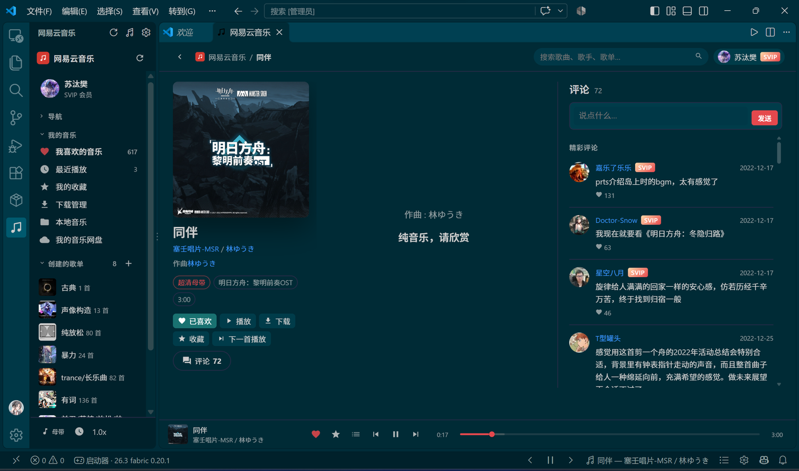
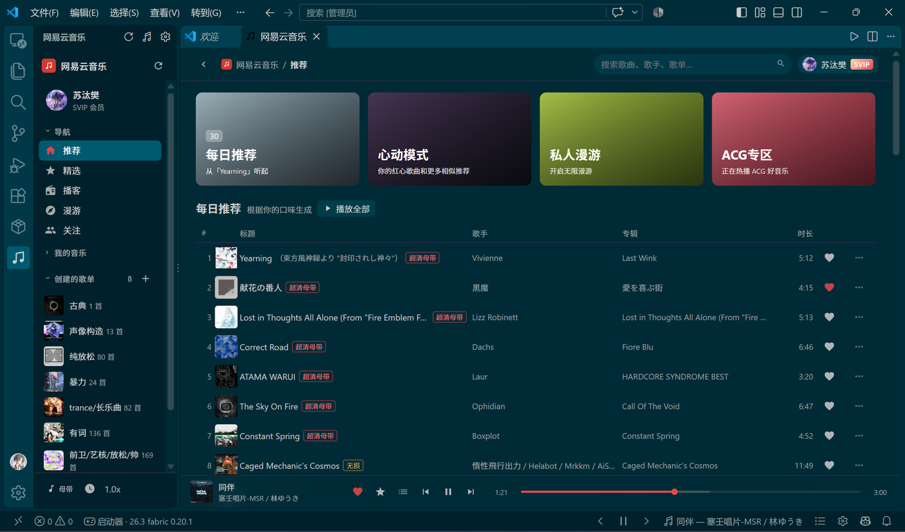
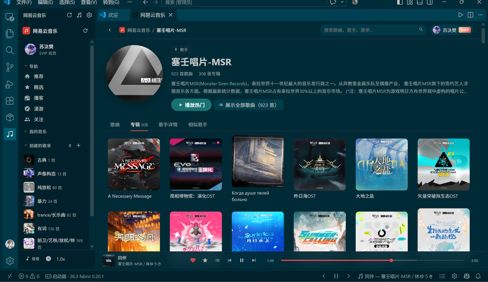

## 原生音频技术文档

- [音频引擎架构、WASAPI 独占、ASIO、Bit-perfect、流式解码与故障排查](AUDIO_ENGINE.md)

# 网易云音乐 for VS Code

在 VS Code 里运行一个**桌面客户端形态**的网易云音乐：侧边栏管理歌单，编辑器区浏览歌曲、歌手、专辑、评论，底部状态栏控制播放。数据通过 EAPI（桌面客户端协议）获取，可选 Windows WASAPI / Linux ALSA 原生音频输出。

> 仅用于个人学习与自用。音乐版权归网易云音乐及各版权方所有，请使用自己的账号并遵守服务条款。
>
> 扩展不会加载网易云网页播放器，登录、歌单、搜索、歌词、评论和播放地址都由扩展宿主请求。

## 开发者个人使用界面

以下截图来自开发者个人账号与个人使用环境，仅用于展示界面形态。

### 歌曲详情 / 歌词 / 评论



### 推荐页分类



### 歌手页与专辑



## 功能

### 浏览与发现

- 推荐页分类：每日推荐、心动模式、私人漫游、ACG 专区、推荐歌单、排行榜、最新音乐。
- 歌单：歌曲 / 评论 / 收藏者标签；播放全部、加入队列、下载、收藏、收藏到歌单。
- 歌单排序：标题、歌手、专辑、时长多列排序；喜欢支持默认 / 喜欢优先 / 喜欢靠后三态。
- 歌单搜索：在当前歌单内查找歌曲。
- 我喜欢的音乐：默认全部红心，喜欢集合全局同步。
- 歌手页：歌曲、专辑、歌手详情、相似歌手；前 50 首预览排序，全部歌曲分页加载。
- 专辑页、用户主页、最近播放、播放队列、本地音乐、音乐网盘。
- 全局搜索：综合、单曲、歌单、专辑、歌手、用户、歌词、声音。
- 播客 / 声音：歌曲详情式详情页和节目列表。
- 当前歌曲定位：在歌单、专辑、歌手、搜索、队列等列表里滚动到正在播放的歌曲。

### 播放

- 播放 / 暂停、上一首 / 下一首、进度、音量。
- 顺序、随机、列表循环、单曲循环。
- 播放倍速（0.75x–2x）、定时关闭。
- 音质档位：标准、极高、无损、Hi-Res、臻音、环绕、母带；以服务端实际返回为准。
- 原生音频组件：Windows WASAPI Shared/Exclusive、Linux ALSA；也可使用 WebAudio 回退。
- 关闭主界面后继续播放。

### 歌曲与评论

- 歌曲详情：大封面、歌词、评论、发送评论。
- 点击封面放大预览，可下载封面。
- 封面保存目录和命名可配置，默认 `{name} - {artist}`。
- 评论区滚动到底自动加载下一页，不需要手动点“加载更多”。
- 歌曲右键：添加/取消喜欢、收藏到歌单、从歌单删除、下一首播放、复制歌曲名/歌手名、查看专辑/歌手、下载。
- 本地音乐：扫描下载目录或自定义目录，支持 mp3 / flac / m4a / wav / ogg / ape。
- 离线本地详情：无网络时显示提示，联网后自动重试评论。

### 歌单管理

- 侧边栏新建歌单。
- 删除歌单、上移 / 下移自定义顺序。
- 我喜欢的音乐不可删除。
- 自定义顺序保存在本地。

### 界面

- PC 风 Activity Bar 侧边栏。
- 三栏歌曲详情：封面信息、歌词、评论；窄窗口自动切换两栏/单栏。
- 固定表头排序栏。
- 深色/浅色主题跟随 VS Code。
- 状态栏：上一首、播放/暂停、下一首、歌名跑马灯、队列、设置。

## 安装

### VS Code 插件市场

在 VS Code 扩展面板搜索 **网易云音乐** 或 **Netease Music**，选择发布者为 `AICis` 的扩展安装。

也可以直接打开：

```text
vscode:extension/AICis.netease-music
```

### VSIX

从 [GitHub Releases](https://github.com/SuperTairitsuFan/Netease-Music-VScode/releases) 下载对应平台的 `.vsix`，然后：

```bash
code --install-extension netease-music-0.3.11-win32-x64.vsix
```

当前市场包目标平台为 **Windows x64**；其他平台可从源码构建。

## 使用

1. 点击 Activity Bar 的音乐图标打开侧边栏。
2. 登录：扫码、手机验证码、手机密码或邮箱密码。
3. 点击歌单、歌手、搜索开始浏览。
4. 底栏控制播放；点击歌名打开歌曲详情。
5. 设置：状态栏齿轮，或命令面板 `网易云音乐: 打开设置`。

## 从源码构建

要求 Node.js ≥ 20、npm。构建原生组件还需要 [zig](https://ziglang.org/) 0.15.x。

```bash
npm install
npm run typecheck
npm run build
npm test
```

打包 Windows x64 VSIX：

```bash
node scripts/package.mjs win32-x64 --skip-build
```

产物位于 `dist-vsix/`。

## 数据与隐私

- 登录 Cookie 保存在 VS Code SecretStorage。
- 不向第三方服务器发送账号信息。
- 播放、搜索、评论请求直接发往网易云音乐接口。
- 本项目不包含音源文件，下载功能仅用于账号有权访问的内容。

## 反馈

- Issues: https://github.com/SuperTairitsuFan/Netease-Music-VScode/issues
- 仓库: https://github.com/SuperTairitsuFan/Netease-Music-VScode

## License

MIT
